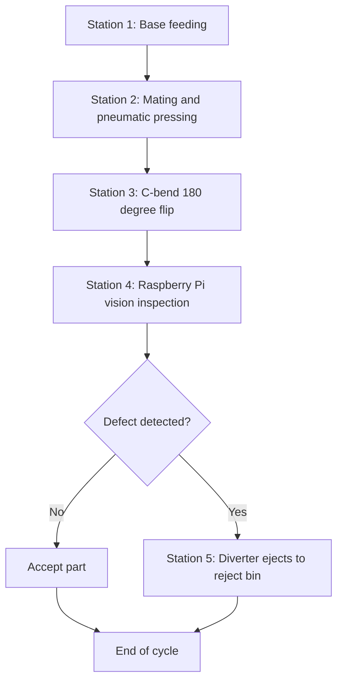

# End-to-End Intelligent Vision System for Automate Product Assembly Defect Detection and Segregation

A low-cost, PLC-controlled electro-pneumatic assembly cell that presses, inspects and sorts tap-cap assemblies on the fly. A Raspberry Pi 4 with OpenCV replaces a proprietary smart camera, so small manufacturers get industrial-grade automation without heavy capital expenditure.

**Submitted to:** Vishwakarma Awards 2026-27 (Stage 2)
**Institution:** Sri Ramakrishna Engineering College
**Team:**  Adhavan M,Hariharasudhan G,Sivapiriyan A R,Sridarshan A

---

## Table of Contents
1. [Problem Statement](#problem-statement)
2. [Proposed Solution](#proposed-solution)
3. [Process Workflow](#process-workflow)
4. [Key Features](#key-features)
5. [System Architecture](#system-architecture)
6. [Technical Specifications](#technical-specifications)
7. [Bill of Materials](#bill-of-materials)
8. [Electro-Pneumatic Circuit](#electro-pneumatic-circuit)
9. [PLC Ladder Logic](#plc-ladder-logic)
10. [Vision Inspection](#vision-inspection)
11. [Mechanical Design](#mechanical-design)
12. [Safety and Fail-Safes](#safety-and-fail-safes)
13. [Risks and Mitigation](#risks-and-mitigation)
14. [Implementation Plan](#implementation-plan)
15. [Scalability and Future Development](#scalability-and-future-development)
16. [Repository Structure](#repository-structure)
17. [Project Status](#project-status)
18. [References](#references)

---

## Problem Statement
Local neighbourhood manufacturing units depend on manual labour for component assembly, pressing and visual quality control. This causes:

- Physical fatigue for operators
- Inconsistent pressing force from part to part
- Subjective visual inspection that misses text smudges, surface scratches and improper mating air gaps

Industrial smart-camera systems and PLCs can automate these tasks, but they are expensive and tied to proprietary software, which puts them out of reach for Micro, Small and Medium Enterprises (MSMEs) and regional workshops.

**Target beneficiaries:** local manufacturing units, MSMEs and regional assembly workshops that need consistent, automated, low-cost assembly and inspection.

## Proposed Solution
A modular electro-pneumatic assembly line built on a T-slot aluminium frame:

- Pneumatic cylinders, controlled by a standard industrial PLC, replace manual handling and pressing.
- An open-source Raspberry Pi edge-computing cell performs high-speed visual quality control.
- A pneumatic diverter rejects defective parts without stopping the conveyor.

The parts assembled are a transparent base cap and a white top cap carrying the "LEO" label.

## Process Workflow



| Station | Function |
|---|---|
| 1. Base feeding | A mechanical feeder drops the base component onto the conveyor. |
| 2. Mating and pressing | A second feeder places the labelled top component on the base; a vertical pneumatic cylinder presses the two parts together. |
| 3. C-bend inversion | A passive, gravity-driven C-type bend flips the assembly 180 degrees to expose the labelled side. |
| 4. Vision inspection | The part stops under the Raspberry Pi camera; image processing verifies the label and checks for defects. |
| 5. Pneumatic sorting | If a defect is found, the PLC fires an electro-pneumatic diverter that pushes the part into the reject bin while the conveyor keeps running. |

## Key Features
- **Edge vision:** Raspberry Pi 4 with a Pi Camera Module over CSI for low-latency frame capture.
- **Defect logic:** image subtraction and edge detection to check "LEO" text integrity (missing ink, smudges), surface scratches and out-of-tolerance mating air gaps.
- **Industrial control:** 24 V PLC with memory-latching circuits and fail-safe interrupt loops.
- **Safe signal bridging:** optocoupler isolation boards connect the 3.3 V Raspberry Pi GPIO to 24 V PLC logic.
- **Zero-downtime rejection:** defects are ejected on the fly with no conveyor stop.
- **Open and serviceable:** standard cylinders, 5/2 valves, T-slot frame and open-source vision software, with no vendor lock-in.

## System Architecture

| Subsystem | Contents |
|---|---|
| Mechanical structure | T-slot aluminium frame, two gravity feeders with optical sensors, conveyor, passive C-bend, adjustable camera arch |
| Actuation and power | Double-acting pneumatic cylinders, 5/2 solenoid valves on a central manifold, 24 V DC supply, conveyor drives |
| Electronic controllers | Delta PLC, Raspberry Pi 4 and camera, optocoupler boards, DIN-rail control cabinet |
| Firmware and logic | OpenCV inspection pipeline, PLC ladder program with latching, timers and counters |

**Signal path (vision result to pneumatic action):**
Pi Camera (CSI) → Raspberry Pi (OpenCV) → GPIO 3.3 V → optocoupler → PLC input 24 V → solenoid valve → diverter cylinder

## Technical Specifications

| Parameter | Specification |
|---|---|
| Process | 5-station inline cycle: feed, press, flip, inspect, sort |
| Actuation | 4 double-acting cylinders, 25 mm x 50 mm (as modelled), 5/2-way solenoid valves, 10 bar supply (simulated) |
| Control | 24 V DC logic; Delta PLC programmed in WPLSoft ladder |
| Vision | Raspberry Pi 4, Pi Camera Module (CSI), white LED lighting, OpenCV |
| Checks per part | Label text integrity, smudges, scratches, mating air gap |
| Interface | Optocoupler isolation, 3.3 V to 24 V |
| Wiring | PVC slotted ducts; 24 V power and 3.3 V data routed separately |
| Structure | T-slot aluminium extrusion, T-nuts, corner brackets, DIN rails |

## Bill of Materials

| Component | Specification | Qty |
|---|---|---|
| PLC | Delta PLC, 24 V DC I/O, WPLSoft programmable | 1 |
| Edge computer | Raspberry Pi 4 | 1 |
| Camera and lighting | Pi Camera Module (CSI) + white LED module on articulating bracket | 1 set |
| Pneumatic cylinders | Double-acting, 25 mm x 50 mm (press, diverter, feeder gates) | 4 |
| Valves and manifold | 5/2-way 24 V DC solenoid valves on a central manifold block | 4 |
| Conveyor | Linear transport with two drive motors | 1 set |
| Sensors and isolation | Optical sensors for feeders and trigger; optocoupler boards 3.3 V to 24 V | 1 set |
| Frame and cabinet | T-slot extrusion, T-nuts, DIN rails, relays, 24 V supply, PVC ducts | 1 lot |

All items are standard, off-the-shelf parts available through local suppliers.

## Electro-Pneumatic Circuit
Modelled and simulated in **Automation Studio** as a digital twin before building hardware.

- **Inputs (24 V):** start trigger, four cylinder-extended sensors, `Vision_Pass`, conveyor transfer sensor
- **Outputs:** four solenoid coils (Sol 1 to Sol 4) and the conveyor drives
- **Pneumatics:** four double-acting cylinders on 5/2 valves, 10 bar supply

See `simulation/` for the circuit files.

## PLC Ladder Logic
Programmed in **Delta WPLSoft**.

| Element | Behaviour |
|---|---|
| `Y0` | Seal-in (latched) run output: `X0` starts, NC contacts `X1` and `C1` stop |
| `X2` to `X4` | Drive memory bits `M0` to `M2` |
| `T0` (K5) | Timer on the `M2` step, driving `M3` |
| `C0`, `C1` (K10) | Counters on sensor inputs `X5` and `X6` |
| `X7` | Drives output `Y1` |
| `T1` (K100) | Resets counters `C0` and `C1` |

Memory latching keeps machine states without continuous operator input, and NC contacts act as fail-safe interrupts.

## Vision Inspection
**Hardware:** Raspberry Pi 4, Pi Camera Module (CSI), white LED lighting on adjustable articulating brackets for focus tuning and shadow removal.

**Software approach (OpenCV):**
1. Capture a frame when the part is in position under the camera.
2. Compare against a golden-reference image using image subtraction.
3. Apply edge detection to verify "LEO" text integrity, find scratches and measure the mating air gap.
4. Output a single OK / NOT OK result on a GPIO pin to the PLC through the optocoupler.

**Rejection rule:** a part is NOT OK if the label is missing, letters are smudged, air bubbles or scratches are present, or the mating gap is out of tolerance.

## Mechanical Design
- **Frame:** T-slot aluminium extrusion for rigidity and quick re-configuration without welding.
- **Fastening:** heavy-duty T-nuts and corner brackets keep cylinders and sensors stable under repeated pressing.
- **Feeders:** stacked magazines with gate release and optical presence sensors.
- **C-bend:** passive gravity track that flips parts 180 degrees with no energy.
- **Camera arch:** adjustable bracket for the camera and LED lighting.
- **Segregation:** diverter cylinder pushes NOT OK parts into a reject bin.

Drawings and renders are in `cad/`.

## Safety and Fail-Safes

| Failure mode | Mitigation |
|---|---|
| Fault while press is active | Hardwired NC loops drop the output coils and de-energise the press |
| Vision false accept / reject | Controlled LED lighting, golden-reference subtraction, single OK / NOT OK result to the PLC |
| 3.3 V GPIO meets 24 V logic | Optocoupler isolation; separate ducts for data and power |
| Cylinder jam or air loss | Cylinder-extended sensors confirm each stroke before the cycle advances |
| Feeder empty or jammed | Optical sensors confirm parts on each stack |

Also included: emergency-stop and machine guarding. Reference standards: ISO 4414, IEC 60204-1, ISO 12100.

## Risks and Mitigation

| Risk | Primary solution | Fallback |
|---|---|---|
| Low-contrast defects on translucent parts | Adjustable LED lighting, golden-reference subtraction, threshold tuning | Back-lighting or low-angle lighting, second inspection angle |
| 3.3 V / 24 V interface | Optocoupler boards, separate ducts | Relay interface board |
| Rejection timing | Sensor-triggered tracking with PLC timer delay | Slower conveyor or extra trigger sensor |
| Flip and feed consistency | Adjustable C-bend and fixtures, optical stack sensors | Guide rails or small pneumatic assist |

## Implementation Plan

| Phase | Deliverable |
|---|---|
| 1. Vision pipeline | Set up Pi 4 and camera; develop and test OpenCV checks for label, smudges, scratches and air gaps |
| 2. Mechanical build | Assemble T-slot frame, conveyor, C-bend and camera arch |
| 3. Pneumatics and wiring | Mount cylinders, pipe 5/2 valves to the manifold, wire optocoupler boards |
| 4. PLC integration | Load ladder logic with latching and fail-safe loops; integrate the Pi |
| 5. Integrated testing | End-to-end cycle validation, cycle-time and diverter-timing tuning, benchmark detection and rejection |

Planned over 4 months, ending in a working prototype for live demonstration.

## Scalability and Future Development
- **Chained cells:** the standard frame lets several cells be linked for multi-stage assembly.
- **Vision expansion:** the open-source software can be updated for new branding, colours or defect types with no licence fees.
- **Multi-part handling:** cylinder strokes, press fixtures and the C-bend geometry can be adjusted or swapped for different part sizes.

## Repository Structure

```
.
├── README.md
├── presentation/      Stage 2 presentation (.pptx)
├── docs/              Proposal and project report
├── cad/               3D model files and 2D engineering drawing
├── simulation/        Automation Studio electro-pneumatic circuit
├── plc/               Delta WPLSoft ladder program
├── vision/            Raspberry Pi / OpenCV inspection code
└── images/            Photos and renders
```
[CLICK HERE FOR 3D CAD FILE GOOGLE LINK](https://drive.google.com/drive/folders/18YnDShiRJCulWh5oLK0VOjASGSmF6tQN?usp=sharing)
## Project Status
- Complete: 3D CAD, 2D drawing, electro-pneumatic simulation, PLC ladder logic, vision approach defined.
- In progress / planned: fabrication, vision tuning and integrated cell testing.

## References
- OpenCV documentation: https://docs.opencv.org
- Raspberry Pi documentation: https://www.raspberrypi.com/documentation
- Delta PLC and WPLSoft: https://www.deltaww.com
- Automation Studio (Famic Technologies)
- ISO 4414, IEC 60204-1, ISO 12100
